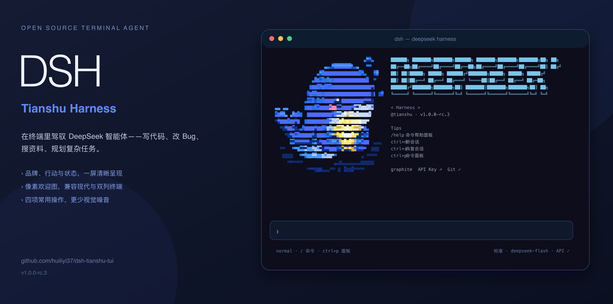

# dsh-tianshu-tui

**把 DeepSeek Harness 变成完整、流畅的终端编程工作区。**

[](https://www.npmjs.com/package/@huiliyi37/dsh-tianshu-tui)
[](https://github.com/huiliyi37/dsh-tianshu-tui/releases)
[](https://www.npmjs.com/package/@huiliyi37/dsh-tianshu-tui)
[](LICENSE)
[](https://dshfind.com/zh/plugins/huiliyi37/dsh-tianshu-tui?ref=badge)
[](https://tianshuharness.com/)
[](https://github.com/huiliyi37/Tianshu-harness)
[](https://tianshu.club/)

中文 · [English](README.en.md)



`dsh-tianshu-tui` 是官方 [DeepSeek Harness](https://github.com/deepseek-ai/deepseek-harness) 的交互式终端 UI 插件。自研轻量 ANSI 渲染引擎，提供流式 Markdown、工具卡、会话恢复与回退、图片与视觉桥、LSP 诊断、16 个主题，以及完整的 slash 命令和快捷键体系。

它是一个**纯展示层插件**：agent 状态来自会话事件流，不另建一套 agent 循环，也不向模型偷偷注入 prompt 或工具。

## 核心体验

| 能力 | 你可以做什么 |
|---|---|
| **流畅对话与工具视图** | 流式 Markdown、推理过程折叠、并行工具分组、结构化 diff、回合耗时与 token 指标 |
| **完整会话工作区** | 恢复、切换、分叉、回退、导出会话；运行中排队，或通过 `/steer` 即时纠偏 |
| **高效输入** | slash 菜单、`@` 路径补全、历史搜索、多行粘贴、外部编辑器，以及可选 Vim 键位 |
| **图片与视觉** | 粘贴并内联预览图片；识图模型直接接收，文本模型可经视觉桥获得图片描述 |
| **Agent 控制面板** | 审批 diff、plan 模式、目标、任务、技能、子代理与 workflow 状态集中呈现 |
| **可定制的开发环境** | 16 个主题、LSP 诊断、项目记忆、MCP 浏览、模型与推理等级热切换 |

## 快速开始

### 环境要求

| 组件 | 当前验证版本 |
|---|---|
| Node.js | `^22.19 || >=24` |
| 包管理器 | [`pnpm`](https://pnpm.io/installation)，可由 `corepack enable` 启用 |
| DeepSeek Harness | `@deepseek-ai/dsh@0.2.1-rc.4`，即 npm `next` 通道 |
| 本插件 | `@huiliyi37/dsh-tianshu-tui@1.0.0-rc.3` |

> **请显式使用宿主 `@next`。** 不要用宿主 `@latest` 代替（当前为 `0.2.1-rc.2`，低于要求）；`@alpha` 的 `0.2.2-alpha.2` 存在已知 API 不兼容，暂不支持。本包也不是可独立运行的 CLI。

### 一键安装（推荐）

脚本会检查 Node/pnpm、安装官方 CLI、装配插件并启动：

```sh
# macOS / Linux
bash <(curl -fsSL https://raw.githubusercontent.com/huiliyi37/dsh-tianshu-tui/main/scripts/install-tui.sh)
```

```powershell
# Windows PowerShell
powershell -ExecutionPolicy Bypass -Command "irm https://raw.githubusercontent.com/huiliyi37/dsh-tianshu-tui/main/scripts/install-tui.ps1 | iex"
```

只安装、不启动：macOS/Linux 在命令末尾加 `--no-launch`；Windows 克隆仓库后运行 `powershell -ExecutionPolicy Bypass -File scripts\install-tui.ps1 -NoLaunch`。

### 手动安装

```sh
# 1. 将插件装入独立的 tui profile
pnpm dlx @deepseek-ai/dsh@next plugin --profile tui add @huiliyi37/dsh-tianshu-tui

# 2. 启动
pnpm dlx @deepseek-ai/dsh@next --profile tui
```

首次启动后按引导配置 API Key，或输入 `/key`。看到 **dsh-tianshu-tui** 欢迎页即安装成功；按 `Ctrl+Q` 或输入 `/exit` 退出。

> 如果旧全局 `dsh` 导致 `ERR_FS_EISDIR`，或 npm 11 安装大型依赖树时发生 OOM，请改用上面的 `pnpm dlx` 命令。更多安装与排障方式见[快速开始文档](docs/getting-started.md)。

## 常用操作

### 常用命令

| 命令 | 作用 |
|---|---|
| `/session` | 新建、列出、切换或恢复会话 |
| `/fork` · `/rewind` | 分叉探索，或回退到历史消息边界 |
| `/model` · `/effort` | 切换当前会话的模型与推理等级 |
| `/preset` | 查看或切换 standard / PTC / minimal / creative 预设 |
| `/status` · `/tasks` · `/subagents` | 查看目标、任务与子代理状态 |
| `/theme` · `/density` | 切换主题与紧凑渲染 |
| `/scroll` · `/export` | 浏览完整转录，或导出 Markdown |

### 快捷键

| 按键 | 作用 |
|---|---|
| `Enter` | 发送 |
| `Shift+Enter` | 换行（或 `\`+Enter 续行） |
| `Ctrl+N` | 新会话 |
| `Ctrl+S` | 恢复最近会话 |
| `Ctrl+Q` | 退出（同 `/exit`） |
| `Ctrl+P` | 命令面板 |
| `Ctrl+.` | 完整键位表 |
| `Ctrl+F` / `Ctrl+R` | 历史搜索；`n`/`N` 下一个，`p`/`P` 上一个 |
| `Ctrl+O` | 展开/收起最近推理块 |
| `Ctrl+E` | 用 `$EDITOR` 编辑输入行 |
| `Ctrl+T` | 中轮转向 |
| `Ctrl+Enter` | 打断当前回合并立即发送草稿（需 kitty 键盘协议） |
| `Ctrl+C` | 打断在途回合；空闲空输入时双击退出 |
| `Ctrl+V` | 粘贴剪贴板图片，无图时粘贴文本 |
| `Alt+W` | 经 OSC52 把选区复制到系统剪贴板 |
| `Shift+Tab` | 循环 normal → plan → always-approve |
| `Tab` | `@` 路径补全；接受 slash 菜单选中项 |
| `Ctrl+U` | 删除到行首 |
| `↑`/`↓` | 输入历史；菜单打开时为选择；空输入 ↑ 取回排队消息 |
| `PageUp`/`PageDown` | slash 菜单翻页 |
| `Esc` | 关闭面板或取消提问；空闲双击打开 rewind |
| `t` | 审批卡：本会话内记住此工具 |
| `a` | 审批卡：本会话放行 |

完整命令、审批操作、Vim 键位和终端协议说明见[交互手册](docs/interaction.md)。

## 更新

从 npm 安装的插件会在启动时检查更新；也可以在 TUI 中输入 `/update` 手动检查。设置 `DSH_TUI_SKIP_UPDATE=1` 可关闭启动检查。

```sh
pnpm dlx @deepseek-ai/dsh@next plugin --profile tui add @huiliyi37/dsh-tianshu-tui
```

当前版本：**[`1.0.0-rc.3`](https://github.com/huiliyi37/dsh-tianshu-tui/releases/tag/v1.0.0-rc.3)**，适配宿主 `0.2.1-rc.4`。版本历史见 [CHANGELOG.md](CHANGELOG.md)，TUI 内可输入 `/changelog` 查看。

## 文档

| 文档 | 内容 |
|---|---|
| [快速开始](docs/getting-started.md) | 安装、启动、干净环境安装与故障排查 |
| [交互手册](docs/interaction.md) | 全部命令、快捷键、面板与输入方式 |
| [配置](docs/configuration.md) | 装配选项、环境变量、预设与运行时配置 |
| [主题](docs/themes.md) | 内置主题、自定义配色与终端降级 |
| [插件生态](docs/plugins.md) | 伴生插件与扩展点 |
| [架构](docs/architecture.md) · [适配契约](ADAPTER.md) | 分层、事件流、服务依赖与展示层边界 |
| [VS Code](docs/vscode.md) | 在 VS Code 终端中使用 |
| [贡献指南](CONTRIBUTING.md) · [开发说明](DEVELOPING.md) | 本地开发、构建、测试与发布流程 |

## 设计原则

- **事件驱动**：所有渲染状态派生自会话事件流，恢复与实时显示走同一套转录桥。
- **不越过展示层边界**：不注册自有 prompt、工具或上下文面，不直接改写 agent 请求体。
- **明确降级**：宿主可选服务缺失时，对应面板会说明原因，不静默空白，也不阻塞启动。
- **终端友好**：支持窄屏、16 色与 `NO_COLOR`，并针对中文宽字符、长输出和流式刷新优化。

实现细节与边界约束见[架构文档](docs/architecture.md)和 [ADAPTER.md](ADAPTER.md)。

## 已知限制

- `ask_image` 图片再询问需要同仓伴生插件 [`vision-ask`](vision-ask/README.md)；基础图片提交与视觉桥不依赖它。
- LSP server 采用懒启动；大型仓库可能常驻较多内存，切换会话时 `rootUri` 仍沿用首个会话目录。
- 上游 schedule 依赖 Web `sessionController`，当前 TUI 未挂载该工具面。
- `0.2.2-alpha.2` 的模型选择与预设 API 已发生变化，完成专项适配前请停留在宿主 `0.2.1-rc.4`。

## 参与贡献

欢迎提交 Issue 和 PR。开始前请阅读[贡献指南](CONTRIBUTING.md)，改动后运行：

```sh
npm run typecheck
npm test
npm run build
```

## 官网与社区

| 入口 | 说明 |
|---|---|
| **[天枢 Harness 官网](https://tianshuharness.com/)** | 官方网站与项目介绍 |
| **[Tianshu-harness 上游项目](https://github.com/huiliyi37/Tianshu-harness)** | 上游源码、Issue 与版本动态 |
| **[天枢论坛](https://tianshu.club/)** | 使用交流、经验分享与问题讨论 |

## 社区生态

| 项目 | 简介 |
|---|---|
| [dshfind](https://dshfind.com/zh) | DeepSeek Harness 中文学习与插件社区 |
| [dsh-web-ui](https://github.com/zhu1090093659/dsh-web-ui) | DSH Web UI 插件与皮肤合集 |
| [dsh-TUI](https://github.com/ccch1mneyyy/dsh-TUI) | Claude Code 风格全屏终端插件 |
| [deepseek-harness-ux](https://github.com/ayuanwong/deepseek-harness-ux) | 长任务进度聚焦与历史自动折叠 |
| [DSH-better-sidebar](https://github.com/omdsh-dev/DSH-better-sidebar) | 文件、终端、Git 与子代理侧边栏工作台 |
| [DSH Desktop](https://github.com/anywhere-labs/deepseek-harness-desktop) | 社区桌面端与远程任务控制 |
| [dsh-whale-report](https://github.com/SenmuuuuW/dsh-whale-report) | 会话、成本、工具调用与风险报告 |

## 许可与来源

基于 [Apache-2.0](LICENSE) 开源。终端渲染引擎从作者的[天枢 Tianshu-harness](https://github.com/huiliyi37/Tianshu-harness) 演进而来；逐文件来源与修改声明见 [SOURCE-MAP.md](SOURCE-MAP.md) 和 [NOTICE](NOTICE)。
